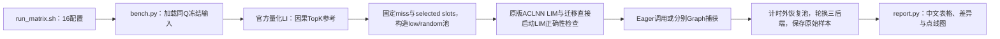

# A5 LIM MTP 手动性能与正确性对照

| 下达任务 | 交付状态 | 范围与限制 |
| --- | --- | --- |
| A3、A5分工作区和分支 | ✅ 已隔离 | 本目录属于A5分支；不修改A3工作区 |
| A5算子级MTP3调用适配 | ✅ 已准备 | 现有A5原语已支持Q1–Q14；驱动将MTP0映射到Q1、MTP3映射到Q4，无需改已有ABI |
| 保持非MTP默认行为 | ✅ 源码保持 | 本次仅新增benchmark和CPU测试，不改Q1内核、注册或构建默认值 |
| 原生LI、vLLM原版LIM、SGLang迁移LIM | ✅ 三入口驱动 | A5 FP8量化算子；原版设备OPP需在容器中已经安装 |
| 16种配置与原始样本 | ✅ 已实现 | MTP0/3×Eager/Graph×低ID/分散filler×91%/95%，每项三个后端 |
| A5编译、正确性与性能结论 | ⏳ 待手动运行 | 当前交付机是Windows，没有A5设备；未产生A5实测数值 |
| 中文结果与点线图 | ✅ 生成器已准备 | 运行后生成；没有数据时明确显示缺失，不填A3或模拟性能 |

## 实验回答的问题

主比较是**相同输入、相同调用前缓存下，迁移版LIM相对原版LIM是否变慢**。
同时报告原生LI作为索引基线，分别计算`原版LIM/LI`、`迁移LIM/LI`和
`迁移LIM/原版LIM`。两个LIM都比LI慢，不足以证明迁移引入了劣化。

此包是单算子测试。它不启动模型，不代表真实MTP接受率、CopySFA、KV数据搬运、
整网精度或TPOT。MTP3在这里代表每请求四路query（包含root），而不是完整投机调度。

## 完整配置与差异

所有case共有：BS16、K2048、C12288、32个index head、head dim128、page128，
稳态`request_state=-1`，请求缓存行1–16，row0保留，source池宽默认66944。

为了符合A5独立prefix/tail合同，**稳定前缀是65536，另保留128个tail token，
实际KV长度为65664**。Q4仍按每路因果位置裁剪。A5量化ABI没有A3的`full_visible`
布尔参数，不允许给A5入口多传这个参数。

Q/K是FP8 E4M3FN，weights是BF16，query/key dequant scales是FP32。原始合成张量
在CPU生成，再用A5动态量化；Q1与Q4分别保存量化后的冻结文件，后续case加载原文件。
官方参考使用同一FP8输入和scale的`torch_npu.npu_quant_lightning_indexer`，
TND/PA_BSND、quant mode0、sparse mode3。不能用A3 BF16 LI充当A5参考。

| 维度 | 取值 | 改变内容 |
| --- | --- | --- |
| MTP | 0 / 3 | Q1 / Q4，累计query ends随之改变 |
| 计时模式 | Eager / Graph | 直接调用 / 预热后捕获并重放，三后端分别建图 |
| filler | low / random | 可替换的非TopK resident source低ID集中 / 在整个prefix分散 |
| 命中标签 | 95 / 91 | 按下述并集目标固定缺失数量 |

**命中率沿用此前410/737那张表的口径**：
`目标率 = 1 - 每请求唯一prefix缺失并集 / (Q*2048)`。
它不是“实际唯一TopK并集”作分母，也不是按每路访问次数计算的命中率。

| Q | 95标签缺失数 | 实际目标率 | 91标签缺失数 | 实际目标率 |
| --- | --- | --- | --- | --- |
| Q1 | 102 | 95.01953125% | 184 | 91.015625% |
| Q4 | 410 | 94.9951171875% | 737 | 91.00341796875% |

结果还保存真实selected-prefix并集命中率、逐route访问命中率和每请求计数，
防止与其他vLLM测试的逐route91%混淆。整数token无法精确表示上述标签。

同Q/同命中标签下，low/random保持Q/K/weights/scales、TopK、选中hit槽位、miss集合
和C一致，只改变未选中filler。filler source变了也会改变对应score及槽位配对，
不能把该实验解释为仅改变物理地址。A5 tail使用`C + source - prefix`直接槽位，
始终是hit，不进入prefix pool或miss-copy计划。

## 原版与迁移版的来源

- 迁移基线：个人fork原A5分支`feat/hisparse-lim-copysfa-c8-a5-10-26`，
  本次改动前提交`2765f232a8317d18025f1939aee3207ff215c794`。
- 原A5实现来源：vLLM Ascend PR18383；本仓`UPSTREAM_PROVENANCE.json`保存原版来源和文件SHA。
- 旧提交保留标记：`lim-a5-before-mtp-manual-20261029`；新内容以追加commit交付。

**现有迁移版CMake明确编译vector后处理**：`LIM_SIMT_POSTPROCESS=0`、
`LIM_SIMT_VICTIM_UNPACK=0`。原版默认可能是SIMT，需要额外的UB启动预留。
本次不更改这些默认值，避免影响非MTP路径。请把原版实际编译配置填写到
`ORIGINAL_VARIANT`；不知道就保留`unknown`。这组配置未对齐时，测到的是部署版本
的对照，不能仅凭差值归因于迁移算法本身。

## 在A5容器准备

所有命令都由你在A5容器手动执行。先核实容器、设备映射、空闲卡和端口；本测试
不用服务端口。设备由你指定，脚本不会选卡、停止任务或修改全局已安装wheel。

推荐直接取原A5分支，避免把A3分支拷过去：

```bash
git clone --recursive --single-branch \
  --branch feat/hisparse-lim-copysfa-c8-a5-10-26 \
  https://github.com/McZyWu/sgl-kernel-npu.git sgl-kernel-npu-a5
cd sgl-kernel-npu-a5
git rev-parse HEAD
```

离线使用随交付的git bundle时，先`git clone <bundle绝对路径> sgl-kernel-npu-a5`，
再在所需网络或已有依赖条件下执行`git submodule update --init --recursive`。
bundle保留源提交和子模块指针，不包含CANN、驱动、权重或子模块远端仓库。

容器需要匹配的A5驱动/CANN开发环境、支持FP8量化LI的torch/torch_npu、C++工具链、
pip、ninja，以及已安装的**原版A5量化LIM设备OPP**。
`build_original_binding.py`只编译原版调用封装，不会编译或安装原版设备kernel。
若原版OPP不存在，先按你原版vLLM分支自己的构建说明安装；本包不会自动换成迁移版。

### 构建到私有目录

```bash
source /usr/local/Ascend/ascend-toolkit/set_env.sh
# 填写你已核对的原版vLLM Ascend源码目录，须含PR18383量化LIM及其ACLNN adapter。
export VLLM_ASCEND_SOURCE=/work/vllm-ascend
# 按原版OPP安装情况配置，保留其官方环境脚本生成的路径。
# export ASCEND_CUSTOM_OPP_PATH=/your/verified/vendor/opp

bash benchmark/lim_a5_mtp_ab/build_private.sh /work/a5-lim-build-001
source /work/a5-lim-build-001/paths.env
```

`build_private.sh`运行`bash build.sh -a kernels Ascend950`，把wheel安装到新目录
`/work/a5-lim-build-001/kernel_runtime`，不覆盖容器全局wheel。
如果设置了`VLLM_ASCEND_SOURCE`，它还会编译独立`a5_original_lim.run`封装，
原样调用原版A5 ACLNN，并输出库SHA、原版source revision和来源manifest。

也可只构建封装：

```bash
python3 benchmark/lim_a5_mtp_ab/build_original_binding.py \
  --source-root "$VLLM_ASCEND_SOURCE" \
  --build-dir /work/a5-original-binding-001
export ORIGINAL_LIM_BINDING=/work/a5-original-binding-001/a5_original_lim_binding.so
```

若容器已有原版扩展，可通过`ORIGINAL_MODULE`和`ORIGINAL_OP`选择原版注册入口，
或把其共享库路径交给`ORIGINAL_LIM_BINDING`。默认封装入口是`a5_original_lim.run`。
原版PR的注册名是`_C_ascend.npu_fused_quant_lightning_indexer_manage`；具体Python导入
模块名称按容器实际安装填写，不猜测。原版入口必须与迁移入口不同。

### 先看配置，不启设备

```bash
python3 benchmark/lim_a5_mtp_ab/bench.py --dry-run
bash benchmark/lim_a5_mtp_ab/run_matrix.sh \
  --output-root /work/a5-lim-results-001 --device npu:0 --dry-run
```

这两项只列配置/命令，不证明A5编译或正确性通过。

### 先跑一个诊断case

```bash
# 物理设备编号由你现场核实；设置后npu:0指可见设备中的逻辑0。
export ASCEND_RT_VISIBLE_DEVICES=0
export PYTHONPATH="$KERNEL_PYTHON_ROOT${PYTHONPATH:+:$PYTHONPATH}"
python3 benchmark/lim_a5_mtp_ab/bench.py \
  --case-id q4_graph_low_hit91 \
  --kernel-python-root "$KERNEL_PYTHON_ROOT" \
  --original-library "$ORIGINAL_LIM_BINDING" \
  --device npu:0 --smoke --output /work/a5-lim-smoke-001
```

smoke只做最小诊断，不会被报告算作正式性能。若TopK集合不一致、pool/plan错误，
保留诊断张量和日志后先定位原因；不要删保护、放宽集合检查或继续混入性能表。

### 正式16配置

```bash
export ORIGINAL_VARIANT=unknown  # 核实原版编译宏后填写，不能凭源码默认推定实际二进制。
bash benchmark/lim_a5_mtp_ab/run_matrix.sh \
  --output-root /work/a5-lim-results-001 --device npu:0 \
  --warmup 20 --rounds 3 --iterations 50 \
  --regression-threshold-pct 5
```

每个case独立进程，case内三个后端交替调用，池恢复在event计时区间外。
每项默认150个正式样本，不删异常值。5%只是可配置告警阈值，未超过它不等于
已证明统计等价；需要结合每轮分布、正确性和环境差异判断。

失败会保留日志并停止余下case；报告把未运行项标为缺失，不填0。每次重跑使用
新的输出根目录，避免覆盖证据。正式模式与smoke分开。

## 如何看结果与打屏日志

以`q4_graph_low_hit91`为例：

```text
/work/a5-lim-results-001/
  preflight/                         设备、环境和运行库检查
  inputs/q1.pt、q4.pt                 同Q组复用的量化冻结输入
  q4_graph_low_hit91/
    command.sh                       实际完整命令与必要环境
    run.log                          stdout和stderr合并打屏
    status                           真实进程退出码
    runner/manifest.json             阶段状态
    runner/case.json                 正确性、原始samples、版本和哈希
    runner/error.json                失败原因（发生失败时）
  REPORT.md                          中文状态、配置、差异、性能和调用链
  report_data.csv、report_data.json  复算汇总
  plots/                             点+均值曲线（有真实有效样本且已装绘图库时）
```

构建日志在`/work/a5-lim-build-001/logs/`，总退出码为`build.exitcode`。
原版封装manifest在`original_binding/binding_manifest.json`，迁移wheel来源在
`source_provenance.json`和`wheel.json`。实际输出文件名以脚本和报告索引为准。

重新生成报告：

```bash
python3 benchmark/lim_a5_mtp_ab/report.py \
  --output-root /work/a5-lim-results-001 --regression-threshold-pct 5
```

计时为Eager NPU event或Graph replay经过时间。前置动态量化、metadata生成、池恢复、
正确性检查不在区间内；LI返回输出、LIM写caller-owned输出，这是接口差异。
event时间也可能包含主机提交间隙，不能直接称为纯kernel活跃时间。
若后续需要分析差值来源，另做独立profiling；不要把profiler运行混入正式均值。

## 调用链



## 保留旧版本与回退

本次只增加测试工具，原有kernel和Q1行为不改。旧提交与备份标记保留，不做
amend、rebase或force-push。需要撤销工具提交时，在原A5分支使用`git revert <新提交>`
追加反向提交；或在新的独立目录检出`lim-a5-before-mtp-manual-20261029`比较。
不要在有既有改动的工作区直接reset。

运行库使用私有目录；回到原来的Python路径即可选择旧安装，无需卸载全局包。
请保留旧wheel、新wheel和两者SHA，不用新包覆盖旧包文件。
