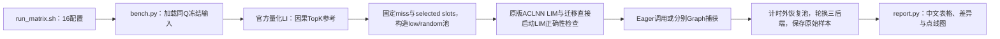

# A5 LIM MTP 手动性能与正确性对照

| 下达任务 | 交付状态 | 范围与限制 |
| --- | --- | --- |
| A3、A5分工作区和分支 | ✅ 已隔离 | 本目录属于A5分支；不修改A3工作区 |
| A5算子级MTP3调用适配 | ✅ 已准备 | 现有A5原语已支持Q1–Q14；驱动将MTP0映射到Q1、MTP3映射到Q4，无需改已有ABI |
| 保持非MTP默认行为 | ✅ 源码保持 | 本次仅新增benchmark和CPU测试，不改Q1内核、注册或构建默认值 |
| 原生LI、PR原版LIM、SGLang迁移LIM | ✅ 三入口驱动 | 随包准备固定PR的原版源码和私有OPP构建，不要求完整vLLM源码或Python包 |
| 容器依赖检查与构建工具 | ✅ 提供入口 | doctor默认不初始化设备；bootstrap只安装私有Python构建工具，CANN和A5适配的torch需容器提供 |
| 16种配置与原始样本 | ✅ 已实现 | MTP0/3×Eager/Graph×低ID/分散filler×91%/95%，每项三个后端 |
| A5编译、正确性与性能结论 | ⏳ 部分构建已有用户日志 | SGLang wheel和原版OPP包已生成；原版安装参数错误已修复，wrapper及设备测试仍待手动验证 |
| 中文结果与点线图 | ✅ 生成器已准备 | 运行后生成；没有数据时明确显示缺失，不填A3或模拟性能 |

## 实验回答的问题

主比较是**相同输入、相同调用前缓存下，迁移版LIM相对原版LIM是否变慢**。
同时报告原生LI作为索引基线，分别计算`原版LIM/LI`、`迁移LIM/LI`和
`迁移LIM/原版LIM`。两个LIM都比LI慢，不足以证明迁移引入了劣化。

此包是单算子测试。它不启动模型，不代表真实MTP接受率、CopySFA、KV数据搬运、
整网精度或TPOT。MTP3在这里代表每请求四路query（包含root），而不是完整投机调度。

## 完整配置与差异

所有case共有：BS16、K2048、C12288、32个index head、head dim128、page128，
稳态`request_state=-1`，请求缓存行1–16，row0保留，source池宽默认66944。

为了符合A5独立prefix/tail合同，**稳定前缀是65536，另保留128个tail token，
实际KV长度为65664**。Q4仍按每路因果位置裁剪。A5量化ABI没有A3的`full_visible`
布尔参数，不允许给A5入口多传这个参数。

Q/K是FP8 E4M3FN，weights是BF16，query/key dequant scales是FP32。原始合成张量
在CPU生成，再用A5动态量化；Q1与Q4分别保存量化后的冻结文件，后续case加载原文件。
官方参考使用同一FP8输入和scale的`torch_npu.npu_quant_lightning_indexer`，
TND/PA_BSND、quant mode0、sparse mode3。不能用A3 BF16 LI充当A5参考。

| 维度 | 取值 | 改变内容 |
| --- | --- | --- |
| MTP | 0 / 3 | Q1 / Q4，累计query ends随之改变 |
| 计时模式 | Eager / Graph | 直接调用 / 预热后捕获并重放，三后端分别建图 |
| filler | low / random | 可替换的非TopK resident source低ID集中 / 在整个prefix分散 |
| 命中标签 | 95 / 91 | 按下述并集目标固定缺失数量 |

**命中率沿用此前410/737那张表的口径**：
`目标率 = 1 - 每请求唯一prefix缺失并集 / (Q*2048)`。
它不是“实际唯一TopK并集”作分母，也不是按每路访问次数计算的命中率。

| Q | 95标签缺失数 | 实际目标率 | 91标签缺失数 | 实际目标率 |
| --- | --- | --- | --- | --- |
| Q1 | 102 | 95.01953125% | 184 | 91.015625% |
| Q4 | 410 | 94.9951171875% | 737 | 91.00341796875% |

结果还保存真实selected-prefix并集命中率、逐route访问命中率和每请求计数，
防止与其他vLLM测试的逐route91%混淆。整数token无法精确表示上述标签。

同Q/同命中标签下，low/random保持Q/K/weights/scales、TopK、选中hit槽位、miss集合
和C一致，只改变未选中filler。filler source变了也会改变对应score及槽位配对，
不能把该实验解释为仅改变物理地址。A5 tail使用`C + source - prefix`直接槽位，
始终是hit，不进入prefix pool或miss-copy计划。

## 原版与迁移版的来源

- 迁移基线：个人fork原A5分支`feat/hisparse-lim-copysfa-c8-a5-10-26`，
  本次改动前提交`2765f232a8317d18025f1939aee3207ff215c794`。
- 原版LIM来源：[vLLM Ascend PR18383](https://github.com/vllm-project/vllm-ascend/pull/18383)，
  固定提交`7d5a4cd9d7e8c4e2e4f0f6415a71f0e80edcff8e`。
- 原版Copy-SFA来源：[PR18490](https://github.com/vllm-project/vllm-ascend/pull/18490)，
  固定提交`1b180deb840484c2fe33cbdd7abb68a615085172`。这是另一个算子，本次LI/LIM计时不包含它。
- 以上版本与当前分支两份`UPSTREAM_PROVENANCE.json`一致。归档保留原文件字节、许可证、
  每文件SHA和来源；不在A5容器下载整个vLLM仓库，也不安装vLLM Python依赖。
- 原版LIM设备/host源码保留原字节；准备器只补两份未选中类别的空CMake目录。
  包中另附json、Abseil、protobuf和makeself构建依赖。CANN的补丁版makeself下载返回401，
  因此包使用官方makeself 2.5.0打包器；已核对所需参数，但未验证A5安装过程。
  这个差别属于安装包生成工具，来源、SHA与限制见`vendor/README.md`和准备manifest。
- 旧提交保留标记：`lim-a5-before-mtp-manual-20261029`；新内容以追加commit交付。

历史direct迁移版的CMake强制vector后处理：`LIM_SIMT_POSTPROCESS=0`、
`LIM_SIMT_VICTIM_UNPACK=0`。当前新分支默认经SGLang正常接口调用固定原版LIM OPP，
保留其SIMT与UB启动配置；构建说明见 `../../tools/a5_c8/README.zh-CN.md`。
使用 `SGL_KERNEL_A5_C8_BACKEND=direct` 显式保留旧direct对照。随包构建记录原版源码、
构建命令、OPP来源和`ORIGINAL_VARIANT`；自行接入其他原版库且不知道配置时保留
`unknown`。runner记录实际sglang backend、runtime manifest及DSO路径。
配置未对齐时不能将差额全部归因于迁移算法；同进程两个OPP vendor可能共享device-op
路由，host DSO路径本身不证明独立device binary执行。

## 在A5容器准备

所有命令都由你在A5容器手动执行。先核实容器、设备映射、空闲卡和端口；本测试
不用服务端口。设备由你指定，脚本不会选卡、停止任务或修改全局已安装wheel。

推荐直接取原A5分支，避免把A3分支拷过去：

```bash
git clone --recursive --single-branch \
  --branch feat/hisparse-lim-copysfa-c8-a5-10-26 \
  https://github.com/McZyWu/sgl-kernel-npu.git sgl-kernel-npu-a5
cd sgl-kernel-npu-a5
git rev-parse HEAD
```

离线使用随交付的git bundle时，先`git clone <bundle绝对路径> sgl-kernel-npu-a5`，
再在所需网络或已有依赖条件下执行`git submodule update --init --recursive`。
bundle保留源提交和子模块指针，不包含CANN、驱动、权重或子模块远端仓库。

容器需要Python 3.10或更新版本、匹配的A5驱动/CANN开发环境、支持FP8量化LI的torch/torch_npu和C++工具链。
本包负责准备原版源码、构建原版设备OPP和独立Torch封装。原版走自己的ACLNN/OPP，
迁移版走当前SGLang直接启动入口。

### 先检查镜像缺什么

```bash
source /usr/local/Ascend/ascend-toolkit/set_env.sh
python3 benchmark/lim_a5_mtp_ab/doctor.py --output /work/a5-doctor.json
```

此命令默认只读软件环境，不导入torch_npu、不创建设备context。缺少构建工具时，
可继续下一步在私有venv补齐。缺少CANN开发文件、A5适配的torch/torch_npu时，
输出会明确列出；这些无法靠普通pip构建依赖补齐，必须使用与你的A5环境匹配的供应方包。
这里没有足够依据指定一个保证可用的镜像标签或盲装某个torch版本。

```bash
bash benchmark/lim_a5_mtp_ab/bootstrap_deps.sh /work/a5-lim-tools-001
source /work/a5-lim-tools-001/paths.env
# 无外网时，在上一条bootstrap命令末尾增加：--wheelhouse /work/build-wheels
python3 benchmark/lim_a5_mtp_ab/doctor.py --output /work/a5-doctor-after.json
```

私有venv继承容器已安装的torch/torch_npu，只补小型构建工具，不替换系统框架或CANN。
默认工具为CMake 3.30.5、Ninja 1.11.1、wheel 0.45.1；这些是构建工具版本，
不表示已确认某一组A5运行时兼容性。补充工具可用`--requirements`传入构建专用版本清单。
第一次doctor失败日志应保留，用于对照实际补齐的项目。构建前doctor必须通过。

### 构建到私有目录

```bash
source /usr/local/Ascend/ascend-toolkit/set_env.sh
source /work/a5-lim-tools-001/paths.env

bash benchmark/lim_a5_mtp_ab/build_private.sh /work/a5-lim-build-001 &&
source /work/a5-lim-build-001/paths.env
```

`build_private.sh`在本次私有源码副本运行`bash build.sh -a kernels Ascend950`，把wheel安装到新目录
`/work/a5-lim-build-001/kernel_runtime`，不覆盖容器全局wheel。
它还会校验随包源码，构建PR18383的原版OPP，安装到本次新建目录，再编译独立
`a5_original_lim.run`封装，输出库SHA、原版source revision和来源manifest。
不用设置`VLLM_ASCEND_SOURCE`，也不要求预先安装原版OPP。
原版启动前还会用原adapter相同的解析器检查两个`WithStrides`符号实际来自哪个共享库，
要求都位于本次私有OPP目录，并记录路径与SHA；解析到其他安装时立即失败。

### 已生成wheel和原版.run，安装参数报错时恢复

若旧版本最后显示：

```text
Unrecognized flag : --install-path=/work/a5-lim-build-001/original/opp
build_original exit code: 1
```

这是标准makeself的外层参数解析拒绝了应传给内层CANN安装脚本的参数。安装调用
已修为`bash "$installer" -- "--install-path=$install_root"`，不修改算子实现。
已有的wheel和`.run`可复用，更新到修复提交后执行：

```bash
source /usr/local/Ascend/ascend-toolkit/set_env.sh
bash benchmark/lim_a5_mtp_ab/recover_private.sh \
  /work/a5-lim-build-001 /work/a5-lim-recover-001 &&
source /work/a5-lim-recover-001/paths.env
```

此命令只在新的恢复目录安装原版OPP、编译wrapper并生成组合路径；复用旧目录中
的SGLang运行库，不重编SG、原版OPP、protobuf或Abseil。旧目录和失败日志保留。
恢复打屏在新目录的`recover.log`，最终退出码为`recover.exitcode`。失败后继续保留该目录，
下次换新恢复目录。仅在恢复退出0并生成新`paths.env`后进入后面的smoke/正式测试。
请在同一容器和Python环境执行；`--python`可显式指定与原wheel构建一致的解释器。
恢复不初始化NPU context。

也可只准备和构建原版：

```bash
bash benchmark/lim_a5_mtp_ab/build_original.sh /work/a5-original-001 &&
source /work/a5-original-001/paths.env
```

若容器已有原版扩展，可通过`ORIGINAL_MODULE`和`ORIGINAL_OP`选择原版注册入口，
或把其共享库路径交给`ORIGINAL_LIM_BINDING`。默认封装入口是`a5_original_lim.run`。
原版PR的注册名是`_C_ascend.npu_fused_quant_lightning_indexer_manage`；具体Python导入
模块名称按容器实际安装填写，不猜测。原版入口必须与迁移入口不同。

### 先看配置，不启设备

```bash
python3 benchmark/lim_a5_mtp_ab/bench.py --dry-run
bash benchmark/lim_a5_mtp_ab/run_matrix.sh \
  --output-root /work/a5-lim-results-001 --device npu:0 --dry-run
```

这两项只列配置/命令，不证明A5编译或正确性通过。

### 先跑一个诊断case

```bash
# 物理设备编号由你现场核实；设置后npu:0指可见设备中的逻辑0。
export ASCEND_RT_VISIBLE_DEVICES=0
export PYTHONPATH="$KERNEL_PYTHON_ROOT${PYTHONPATH:+:$PYTHONPATH}"
python3 benchmark/lim_a5_mtp_ab/bench.py \
  --case-id q4_graph_low_hit91 \
  --kernel-python-root "$KERNEL_PYTHON_ROOT" \
  --original-library "$ORIGINAL_LIM_BINDING" \
  --device npu:0 --smoke --output /work/a5-lim-smoke-001
```

smoke只做最小诊断，不会被报告算作正式性能。若TopK集合不一致、pool/plan错误，
保留诊断张量和日志后先定位原因；不要删保护、放宽集合检查或继续混入性能表。

### 正式16配置

```bash
# 使用build_private生成的paths.env，保留其原版版本与构建变体记录。
bash benchmark/lim_a5_mtp_ab/run_matrix.sh \
  --output-root /work/a5-lim-results-001 --device npu:0 \
  --warmup 20 --rounds 3 --iterations 50 \
  --regression-threshold-pct 5
```

每个case独立进程，case内三个后端交替调用，池恢复在event计时区间外。
每项默认150个正式样本，不删异常值。5%只是可配置告警阈值，未超过它不等于
已证明统计等价；需要结合每轮分布、正确性和环境差异判断。

失败会保留日志并停止余下case；报告把未运行项标为缺失，不填0。每次重跑使用
新的输出根目录，避免覆盖证据。正式模式与smoke分开。

### preflight失败时

预检失败会在16个case开始前停止，所以报告中的全部`missing`表示尚未执行。
终端会显示失败检查、实际退出码、原始日志路径和有长度限制的日志末尾；
Python探针失败时也显示其traceback。映射、基本设备信息和Python/NPU探针检查保留。

当前A5驱动的命令语法为`npu-smi info -m`查询映射、`npu-smi info proc`查询滚动进程信息。
旧版脚本的顶层`npu-smi -m`及`npu-smi info -t proc`会打印帮助或报参数错误，已修正。
进程查询限时采集5秒，非0（包括采集限时到达）只记录；没有timeout工具时记录未采集，
不会启动无界滚动查询。映射、基本信息和Python探针失败仍阻止正式case运行。

原始文件位于`<结果根>/preflight/`：`preflight.log`记录环境/路径问题，
`npu-smi_info_-m.log`和`npu-smi_info.log`保存对应命令输出及退出码，
`python-probe.log`和`runtime.json`保存Python/NPU探针结果。
进程采集结果在`npu-smi_info_proc.log`，不单独导致预检失败。

旧版本只打印`Preflight failed`时，可直接读这些已有日志，不需要重跑矩阵：

```bash
preflight_dir=/work/a5-lim-results-001/preflight
for name in preflight.log npu-smi_-m.log npu-smi_info_-m.log npu-smi_info.log python-probe.log runtime.json; do
  if [ -f "$preflight_dir/$name" ]; then
    printf '\n=== %s ===\n' "$name"
    tail -n 100 "$preflight_dir/$name"
  fi
done
```

保留失败目录。找到并处理实际原因后，再用新的输出目录重试；不要删除日志或跳过检查。

## 如何看结果与打屏日志

以`q4_graph_low_hit91`为例：

```text
/work/a5-lim-results-001/
  preflight/                         设备、环境和运行库检查
  inputs/q1.pt、q4.pt                 同Q组复用的量化冻结输入
  q4_graph_low_hit91/
    command.sh                       实际完整命令与必要环境
    run.log                          stdout和stderr合并打屏
    status                           真实进程退出码
    runner/manifest.json             阶段状态
    runner/case.json                 正确性、原始samples、版本和哈希
    runner/error.json                失败原因（发生失败时）
  REPORT.md                          中文状态、配置、差异、性能和调用链
  report_data.csv、report_data.json  复算汇总
  plots/                             点+均值曲线（有真实有效样本且已装绘图库时）
```

构建日志在`/work/a5-lim-build-001/logs/`，总退出码为`build.exitcode`。
原版完整打屏为`original/build.log`，退出码为`original/exit_code`；
构建工具准备日志为`/work/a5-lim-tools-001/bootstrap.log`和`bootstrap.exitcode`。
原版构建与封装manifest位于`original/`，迁移wheel来源在
`source_provenance.json`和`wheel.json`。实际输出文件名以脚本和报告索引为准。

重新生成报告：

```bash
python3 benchmark/lim_a5_mtp_ab/report.py \
  --output-root /work/a5-lim-results-001 --regression-threshold-pct 5
```

报告读取已有结果，所以这里使用原来的结果目录；无需新建结果目录或重新运行矩阵。
早期报告程序将Graph回放校验只按布尔值`true`读取，而runner实际保存带`passed`
字段的完整校验对象，可能把已成功执行的Graph误标为failed。报告已兼容完整对象和
历史布尔格式，仍要求明确通过、进程退出0、正式轮次/样本及其他正确性条件全部满足。
更新报告脚本后重生成即可重新判定；原始case JSON、退出码与样本不修改。

缺少matplotlib只影响绘图。可以使用独立的CPU报告环境，不替换NPU测试环境的包：

```bash
python3 -m venv /work/a5-report-env-001
/work/a5-report-env-001/bin/python -m pip install matplotlib
/work/a5-report-env-001/bin/python benchmark/lim_a5_mtp_ab/report.py \
  --output-root /work/a5-lim-results-002 --regression-threshold-pct 5
```

报告环境目录也应选一个尚不存在的路径；报告输出目录则指向已经完成测试的目录。
报告脚本只读取已有JSON/样本并绘图，不加载torch、不初始化NPU。

计时为Eager NPU event或Graph replay经过时间。前置动态量化、metadata生成、池恢复、
正确性检查不在区间内；LI返回输出、LIM写caller-owned输出，这是接口差异。
event时间也可能包含主机提交间隙，不能直接称为纯kernel活跃时间。
若后续需要分析差值来源，另做独立profiling；不要把profiler运行混入正式均值。

## 调用链



## 保留旧版本与回退

本次只增加测试工具，原有kernel和Q1行为不改。旧提交与备份标记保留，不做
amend、rebase或force-push。需要撤销工具提交时，在原A5分支使用`git revert <新提交>`
追加反向提交；或在新的独立目录检出`lim-a5-before-mtp-manual-20261029`比较。
不要在有既有改动的工作区直接reset。

运行库使用私有目录；回到原来的Python路径即可选择旧安装，无需卸载全局包。
请保留旧wheel、新wheel和两者SHA，不用新包覆盖旧包文件。
