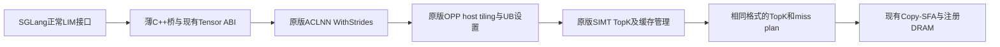

# A5 C8：保留原版 LIM OPP 的生产接入

| 任务 | 状态 | 范围 |
| --- | --- | --- |
| 保留原分支 | ✅ | 从 `503f8a2` 新建 `feat/hisparse-c8-a5-original-10-30` |
| 恢复原版 LIM 执行方式 | ✅ 代码已接入 | 正常 `npu::fused_quant_lightning_indexer_manage` 接口调用固定 PR18383 的 ACLNN/OPP；原始源码、SIMT、UB和host tiling不修改 |
| 普通 wheel 包含私有 OPP | ✅ 构建入口已接入 | Ascend950 默认构建原LIM OPP，随wheel安装并优先使用；不装vLLM Python框架 |
| 保留 Copy-SFA 原生计算 | ✅ | 继续使用已迁入的原版device payload和SGLang注册DRAM地址适配；此项仍为direct启动 |
| CPU逻辑、激活、真实build_py打包检查 | ✅ 45项通过 | marker产物只用于打包测试，不加载NPU库；不代表A5设备通过 |
| 217原OPP交叉编译与新桥C++语法检查 | ✅ | 原OPP编译安装完成；内部链接清单修复后，复用产物恢复/打包/搬迁激活退出均0；未重跑空目录完整构建 |
| A5精度、Graph及性能对齐 | ⏳ | 用户在A5容器执行，不能用217/A3交叉编译替代 |

## 为什么可以使用原版

原版LIM的算法与OPP/ACLNN接口不依赖vLLM的模型调度。旧迁移为了直接编进普通wheel，改成direct launch，并关闭了依赖OPP UB启动配置的SIMT路径；这是原先接入方式的选择，不是SGLang不能使用原版。

本分支保留原版 `7d5a4cd9d7e8c4e2e4f0f6415a71f0e80edcff8e` 源码和构建方式，SGLang增加薄接口桥。源文件来自已有的固定归档和许可证；构建阶段复用仓库的来源校验工具，运行时不依赖benchmark模块或namespace。



Copy-SFA的原PyTorch adapter要求DRAM参数是NPU Tensor，而SGLang持有CPU storage及注册后的设备可见地址。该层必须保留明确的地址与生命周期适配，不能把CPU Tensor直接改标成NPU Tensor。当前Copy-SFA的计算payload继续保持来源，不在本次为改包装而改写计算内核；本次恢复原OPP的是LIM。

## 在A5容器构建

先保留现有精度/性能结果、停止本次自己的服务并核实使用的容器和仓库。以下只构建kernel和原LIM OPP，不重编DeepEP。

```bash
KERNEL=/mnt/share/wzy/sgl-kernel-npu
BRANCH=feat/hisparse-c8-a5-original-10-30

git -C "$KERNEL" fetch https://github.com/McZyWu/sgl-kernel-npu.git "$BRANCH"
git -C "$KERNEL" switch "$BRANCH"
git -C "$KERNEL" pull --ff-only https://github.com/McZyWu/sgl-kernel-npu.git "$BRANCH"

source /usr/local/Ascend/ascend-toolkit/set_env.sh
cd "$KERNEL"
bash build.sh -a kernels Ascend950
sha256sum output/sgl_kernel_npu-*.whl
python3 -m pip install --force-reinstall --no-deps output/sgl_kernel_npu-*.whl
```

选择wheel时确认输出中只有本次目标产物；若有多个wheel，使用构建打屏给出的精确路径，不使用模糊通配符安装。也可继续用原framework的 `bash "$C8_SCRIPT" build-kernel`，其底层调用会走本分支新的默认构建。

构建会在 `output/a5-c8-original-时间-PID/` 留下：

- `build.log`、`exit_code`：原版OPP构建打屏与退出码。
- `prepared/SOURCE_MANIFEST.json`：固定源码与依赖哈希。
- `opp/vendors/sglc8original_transformer/`：本次私有安装，不覆盖系统OPP。
- `installed_files.sha256.json`：安装产物哈希。

最终wheel内包括 `sgl_kernel_npu/lib/a5_original_opp/`。导入包时先校验哈希、设置自有 `ASCEND_CUSTOM_OPP_PATH`，再导入torch_npu和加载算子；实际解析到的ACLNN库必须来自这份wheel中的私有vendor，否则明确报错，不回退旧vector路径。

CANN安装器的内部相对软链接（如`liboptiling.so`）记录在来源清单中。wheel打包时将其指向的同字节内容实体化，保留可见路径，避免wheel安装丢失链接；原始OPP安装目录和算子代码不修改。

整网启动前可在当前shell提前激活，使OPP在第一次设备初始化之前已经可见。该脚本只读安装包元数据和哈希，不导入torch或初始化设备：

```bash
python3 "$KERNEL/tools/a5_c8/env.py" > /workspace/c8-original-opp.env &&
source /workspace/c8-original-opp.env &&
bash "$C8_SCRIPT" serve
```

原OPP已经构建成功、后续主wheel需要重编时可以复用：

```bash
export SGL_KERNEL_A5_C8_PREBUILT=/absolute/path/to/output/a5-c8-original-实际时间-PID
bash build.sh -a kernels Ascend950
```

复用时重新校验固定来源、源文件和安装文件哈希。显式 `SGL_KERNEL_A5_C8_BACKEND=direct` 才构建历史direct LIM；它仅供保留对照，默认值为original。A3没有原OPP依赖。

如果旧版已成功安装OPP，却在生成清单时以 `Unexpected symlink ... liboptiling.so` 结束，可更新到包含内部链接支持的版本后重建清单并复用产物，不用重编原OPP。旧失败日志和退出码保留：

```bash
ORIGINAL_BUILD=/absolute/path/to/output/a5-c8-original-实际时间-PID
python3 tools/a5_c8/record_install.py --build-root "$ORIGINAL_BUILD" &&
SGL_KERNEL_A5_C8_PREBUILT="$ORIGINAL_BUILD" bash build.sh -a kernels Ascend950
```

## 私有构建在桥接文件报 Python.h 缺失

若 `build/sglang_source/csrc/a5_c8_original.cpp` 的 include 栈为
`torch/extension.h -> torch/csrc/python_headers.h -> Python.h`，需要更新本分支。
桥接使用 ATen 和 dispatcher，未使用 Python 扩展绑定；修复删除了多余的
`torch/extension.h`，没有修改原版算子算法、ABI 或 DeepEP。

2026-10-31 在217验证：不添加 Python include 路径，旧文件复现失败；修复后桥接及
原版 `NPUBridge.cpp`、`NPUStorageImpl.cpp` 三个文件编译退出0，使用
`--no-undefined` 链接共享库退出0，依赖清单不含 `Python.h`，无直接 `Py*` 符号依赖。
这是CPU编译/链接验证，尚不代表完整wheel或A5执行验收。

`build_private.sh` 不接受已存在的输出目录。更新源clone后，应使用新输出目录；
原失败目录的 `sglang_source` 是独立副本，更新外层clone不会自动修改它。
若原生产OPP目录 `build/sglang_source/output/a5-c8-original-实际时间-PID/`
的 `exit_code` 为0，且安装清单完整，可以将该目录设为
`SGL_KERNEL_A5_C8_PREBUILT`，再运行 `build_private.sh /新的绝对输出目录`。
脚本会重新校验来源及安装文件哈希，kernel wheel仍重新编译。

此时独立reference OPP通常还未构建：`build_private.sh` 在主wheel成功并私有安装后
才运行 `benchmark/lim_a5_mtp_ab/build_original.sh`。不要将reference vendor
`a5limbaseline_transformer` 的目录作为生产vendor `sglc8original_transformer` 的prebuilt。

## 独立reference的Ninja时间戳错误

若主wheel步骤成功，尾段`original/prepared/source/csrc/build`报
`manifest 'build.ninja' still dirty after 100 tries`，并出现Makefile未来165秒提示，
保留当前wheel和失败日志。调用顺序为主wheel→私有安装→独立reference；
reference失败无需重新构建整套kernel。

使用`benchmark/lim_a5_mtp_ab/retry_reference_local.sh`组合恢复环境。它检查主wheel
成功退出码、wheel SHA256与私有安装文件、生产OPP哈希，再仅恢复reference。
新输出根要求本地文件系统，实测写入mtime与当前时间差不超过2秒。
需重建时，CMake/Ninja工具也安装在本地新环境，避免继续使用共享盘工具模块。
不改变系统时间、原OPP源码、生产wheel或DeepEP。

```bash
KERNEL=/mnt/share/wzy/a5-lim-original-1030/sgl-kernel-npu
OLD=/mnt/share/wzy/a5-lim-original-1030/build-pyheader-20261031-065052
LOCAL=/tmp/wzy-a5-reference-$(date +%Y%m%d-%H%M%S)

bash "$KERNEL/benchmark/lim_a5_mtp_ab/retry_reference_local.sh" "$OLD" "$LOCAL" \
  --python /usr/local/python3.12.13/bin/python3 \
  --ascend-env /usr/local/Ascend/ascend-toolkit/set_env.sh
source "$LOCAL/session.env"
```

如果已找到此前完整的标准`build_original.sh`输出，可在上述命令追加
`--reference-root /实际旧reference根`。脚本会校验固定源码、安装文件、binding哈希和
当前torch/torch-npu版本后复用，跳过本地工具安装及OPP编译；验证失败明确退出。
旧`recover_private.sh`生成的不完整回执不属于此标准复用入口。

新建容器不保证旧reference仍在；此前A/B测出original耗时仅说明旧环境里跑过。
旧文件需要位于当前可见挂载中，才能复用。新目录的`retry-reference.log`、
`retry-reference.exitcode`、`wheel-install-proof.json`和`session.env`记录恢复状态。
本地目录后续测试仍会引用，测试结束前保留它。

## 先确认实际加载路径

```bash
python3 - <<'PY'
import json
import torch
import sgl_kernel_npu

print('backend:', torch.ops.npu.a5_c8_backend())
print('ACLNN libraries:', dict(torch.ops.npu.resolve_a5_c8_original_libraries()))
manifest = sgl_kernel_npu._original_opp_manifest
print(json.dumps({key: manifest[key] for key in
                 ('operators', 'operator_backends', 'execution_configuration')}, indent=2))
PY
```

期望LIM为original，Copy-SFA仍为direct。源码默认SIMT设置会记录在manifest中；是否在目标A5正确执行仍要以下设备测试证明。

## 验收顺序

1. 原 `bash "$C8_SCRIPT" test lim` 的146项、`test copy-sfa`、`test pair`、`test framework`，检查真实执行和零跳过。
2. 原 `benchmark/lim_a5_mtp_ab/run_matrix.sh` 的相同冻结输入16个case。使用新结果目录，确认Graph原始status与replay验证。runner会记录实际LIM backend和OPP manifest，不再将新版本写成SIMT=0。
3. 对照已有原版均值和多轮分布，原版/迁移输入、pool、miss、设备、CANN及构建参数对齐；没有稳定回归才算性能验收通过。
4. 整网长短请求smoke、确认长输入进入真实miss路径，再跑GSM8K和整网吞吐/TPOT。旧短请求GSM8K通过不能替代真实miss覆盖。

这份README不声明新的A5数值或性能收益。所有A5运行结果以用户返回的原始日志和JSON为准。

2026-10-30验证边界：217上只进行了CPU交叉编译、四个新桥/注册相关C++翻译单元语法检查、隔离OPP打包与搬迁激活；没有运行NPU请求，也没有在该轮生成完整普通kernel wheel。首版包装脚本在CANN合法内部链接处退出1的日志保留；更新后的记录/stage/激活分别退出0，原installer哈希保持。目标A5仍需重新构建安装kernel wheel并完成数值与性能验收。
